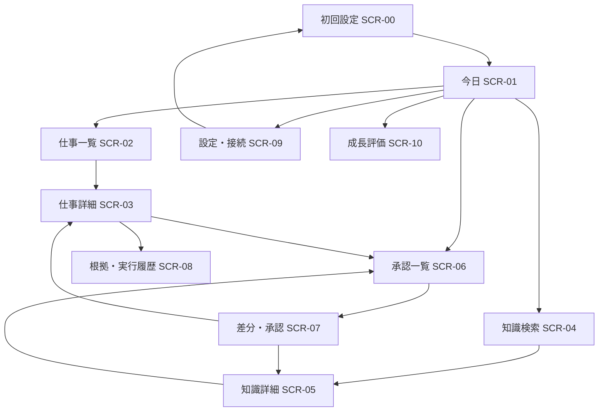

# DOC-02 情報設計・画面遷移

## ナビゲーション
トップナビは `TODAY` / `WORK` / `KNOWLEDGE`。右上の「承認 n件」は横断キューへのショートカット。詳細設定・監査・能力評価は二次メニュー。

## 横断UX
- 全画面に接続状態と最終同期時刻（不明なら不明）を表示する。
- 高リスクアクションは、対象・効果・不可逆性・必要な権限を確認。
- コンテンツなし/読み込み中/停止中/競合/権限不足/索引遅延/機密拒否/再試行不能を各画面で定義。
- スマホでは確認・承認・通知に重点を置き、差分が大きい場合はPCでの確認を推奨。
